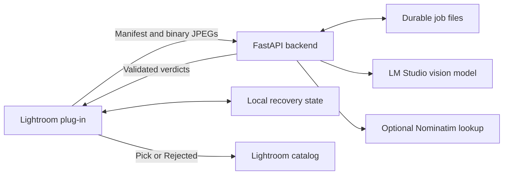

# StockReviewAI

Review photos in **Adobe Lightroom Classic** using an image-capable model
served by LM Studio. The Python backend evaluates stock suitability and returns
a YES/NO verdict, score, reason, and issues. The plug-in can then set Lightroom
Pick/Rejected flags.

**YES → Pick. NO → Rejected.** This is selection assistance, not agency
acceptance, metadata generation, photo editing, or file deletion.

## Contents

- [Requirements and compatibility](#requirements-and-compatibility)
- [Setup](#setup)
- [One-photo walkthrough](#one-photo-walkthrough)
- [Commands and settings](#commands-and-settings)
- [Design and scoring](#design-and-scoring)
- [Recovery and rollback](#recovery-and-rollback)
- [Updating](#updating)
- [Troubleshooting](#troubleshooting)
- [Storage and privacy](#storage-and-privacy)
- [Development and license](#development-and-license)

## Requirements and compatibility

| Component | Requirement and evidence |
|---|---|
| Lightroom | Lightroom Classic, installed separately. Plug-in declares SDK 15.0, minimum 6.0, and version 1.1.0 build 2; this is not a tested Lightroom release matrix. |
| Python | Code uses Python 3.10+ syntax. Existing Windows Python 3.14.4 environment passed 204 unit/mock tests in this documentation review; other versions were not tested here. |
| Model server | LM Studio's OpenAI-compatible chat-completions endpoint with a loaded image-capable model. The configured example is not a verified compatibility guarantee. |
| Photos | Lightroom must export JPEG previews. No complete source-format matrix or dedicated video workflow is established. |
| Network | Backend/model connectivity; optional GPS-based Nominatim lookup can also use the internet. |

GPU/memory requirements depend on the model. Model weights, Lightroom, and
LM Studio are not bundled. Tests do not exercise real Lightroom UI, prove model
accuracy, or certify any photo for a stock agency.

## Setup

### 1. Install the server

In PowerShell:

```powershell
git clone https://github.com/emadaljumah-camel/StockReviewAI.git
cd StockReviewAI\server
python -m venv .venv
.\.venv\Scripts\python.exe -m pip install -r requirements.txt
Copy-Item config.example.yaml config.yaml
```

Only copy the example on first setup. Keep your existing `server/config.yaml`
and environment when updating. The local configuration is ignored by Git.

### 2. Configure LM Studio

Load an image-capable model in LM Studio and start its API server.
Edit these entries in the copied `server/config.yaml`, keeping other sections:

```yaml
lmstudio:
  endpoint: "http://127.0.0.1:1234/v1/chat/completions"
  model: "YOUR-EXACT-LOADED-VISION-MODEL-ID"
  timeout_seconds: 120
  retries: 2
  reasoning_effort: null
```

The endpoint is a **full chat-completions URL**, not just `/v1`.
Find the exact loaded model ID using LM Studio or:

```powershell
Invoke-RestMethod http://127.0.0.1:1234/v1/models
```

This lists IDs, not image capabilities. Leave `reasoning_effort: null` unless
you have verified that your runtime supports the requested setting. It does
not guarantee a particular speed or quality.

Configuration is loaded at startup from `server/config.yaml`; restart after
changes. There is no general environment-variable override or automatic
`.env` loading in this configuration loader. See the
[server configuration guide](server/README.md#configuration).

### 3. Start the backend without changing installed dependencies

From the `server` directory:

```powershell
.\.venv\Scripts\python.exe -m uvicorn main:app --host 127.0.0.1 --port 8001
```

Leave it running. In another shell:

```powershell
Invoke-RestMethod http://127.0.0.1:8001/health
```

Expect `status: ok`. Health checks the process, not inference.
**The supplied `run_server.bat` installs requirements on every launch.**
Use the direct command above to preserve installed dependency versions.

### 4. Install and configure the Lightroom plug-in

1. Open **File > Plug-in Manager > Add** and select
   [StockReviewAI.lrplugin](StockReviewAI.lrplugin/).
2. Select **02 Stock Review AI** and click **Open Settings...**.
3. Set **Endpoint URL** to `http://127.0.0.1:8001/review` for the direct server.
4. Keep **Overwrite existing Lightroom Pick/Rejected flags** disabled initially.
5. Enable **Dry run mode (do not change Lightroom flags)** for your first test.

The initial plug-in URL, `http://localhost:8080/stockreview/review`, assumes an
external reverse proxy. The repository does not start that proxy. Saved
Lightroom settings override initial defaults. Use the direct URL unless you
have deliberately configured the proxy.

The plug-in derives its jobs URL by removing the trailing `/review`.
Do not replace Endpoint URL with a bare `/jobs` URL.

## One-photo walkthrough

1. Select an unflagged, backed-up test photo in Library.
2. With dry-run enabled, run
   **Library > Plug-in Extras > Review Selected Photos for Stock AI**.
3. Wait for the queued acknowledgment. No Lightroom flags change during
   submission.
4. Keep the backend and LM Studio running. Once the job is acknowledged,
   the Lightroom computer may disconnect while the server reviews it.
5. Reconnect and run **Check Job Status / Apply Results**. If still processing,
   check again later.
6. On completion, the command validates results and processes the saved dry-run
   manifest. No flags change; inspect the summary and result log.
7. To apply flags, disable dry-run and **submit a new review**. Existing jobs
   retain their submitted dry-run/overwrite settings.
8. Check that new job when complete. YES becomes Pick and NO becomes Rejected
   unless an existing flag is protected.

There is no separate per-photo verdict approval dialog at application time.
Checking a completed non-dry-run job can immediately change flags. Review the
actual photo yourself; an AI verdict is not an agency decision.

## Commands and settings

| Command | Purpose |
|---|---|
| Review Selected Photos for Stock AI | Export previews and submit a durable background job |
| Check Job Status / Apply Results | Recover upload, check progress, resume interrupted work, download and apply results |
| Cancel Active Job | Confirm cancellation/closure of the saved active job |

Settings are available through Plug-in Manager's **Open Settings...** button.

| Setting | Initial default |
|---|---|
| Endpoint URL | Proxy example `http://localhost:8080/stockreview/review`; change for direct use |
| Preview max long edge | 1536 pixels |
| JPEG quality | 75 |
| Timeout | 120 seconds |
| Minimum YES threshold | 70 |
| Dry run | Off |
| Write AI result log file | On |
| Overwrite existing flags | Off |
| Local job storage | Documents/StockReviewAI Jobs |

With overwrite off, current Pick/Rejected flags are preserved at application
time; unflagged photos may be changed. With overwrite on, returned verdicts can
replace existing flags. Dry-run still exports, uploads, invokes inference, and
may write logs; it prevents catalog flag writes, not processing or networking.

The plug-in writes `pickStatus` only. It does not change star ratings, color
labels, captions, keywords, Develop settings, original image bytes, or folders.
Rejected means a catalog flag, not deletion.

## Design and scoring



AI assesses the image; deterministic backend policies calculate the final
score/verdict; Lightroom controls flag application. No learning database,
fine-tuning, or cloud fallback provider is implemented here. A configured
remote model endpoint still sends data remotely.

The final score combines technical quality (35%), effective composition (25%),
and effective commercial/editorial route value (40%), rounded to an integer.
A hard-reject condition or release-sensitive editorial gate can produce NO
even when the numeric threshold alone would pass. Otherwise, a score at or
above the submitted threshold yields YES.

Composition correctability can cap penalties for normally correctable or
uncertain defects; this does not crop or repair the photo. Location and
release-related assessments constrain editorial/commercial treatment, but
are not factual or legal clearance.

See [architecture, policy, and workflow](docs/ARCHITECTURE.md) for design,
validation, checkpoints, duplicate safeguards, and their limits.

## Recovery and rollback

Only one unresolved client job is tracked at a time.

| State or event | What to do |
|---|---|
| Submission response lost | Check the saved job; do not submit a duplicate solely because the response was lost |
| Running | Check later; keep backend/model available |
| Failed/interrupted | Check status and choose Resume Job; completed checkpoints are reused |
| No longer wanted | Use Cancel Active Job; it closes the local active job after server acknowledgment |
| Completed but unwanted | Cancel Active Job can close it without applying results |
| Application failed | Cached results remain; inspect potentially changed flags before retrying |
| Applied | Ordinary rechecking reports that the job was already applied |

The server marks cancellation immediately; outstanding requests may take time
to finish unwinding. Retained previews/results are not deleted, cancelled jobs
cannot be restarted, and cancellation does not undo flags already changed.

Application uses one Lightroom write-access scope, but there is no explicit
old-flag snapshot/restoration routine or per-photo applied checkpoint. The
job-level applied flag is saved afterward. Do not assume all-or-nothing
rollback or exactly-once application across crashes. Use Lightroom's available
Undo tools or a catalog backup for unwanted flag changes and verify the result.
Never delete/reject originals as a way to test recovery.

## Updating

1. Resolve active jobs, stop the backend, and back up the catalog, local
   configuration, job directories, and logs you need.
2. Check `git status --short`. Preserve local edits. For a clean checkout,
   use `git pull --ff-only`; do not reset changes to force an update.
3. Keep `server/config.yaml` and the existing virtual environment.
   From `server`, run `.\.venv\Scripts\python.exe -m pip check`.
   Review changed requirements separately rather than upgrading automatically.
4. Reload the plug-in if Lightroom loads it from this checkout. If you use a
   separate installed copy, update its complete folder with Lightroom closed,
   preserving configured job storage.
5. Restart the backend with the direct launch command, then test health and
   a one-photo dry-run before applying flags.

Do not recopy the configuration example over local settings. Do not mix
server/plug-in versions during an unresolved job; compatibility of every
historical saved manifest is not guaranteed.

## Troubleshooting

| Symptom | Check |
|---|---|
| Plug-in cannot connect | Replace proxy default with direct `http://127.0.0.1:8001/review` unless your proxy is configured |
| Health works but review fails | Check model ID, image capability, endpoint suffix, and server log |
| Configuration changes ignored | Edit `server/config.yaml` and restart; environment variables do not generally override this loader |
| Flags unchanged | Check saved dry-run setting and existing-flag protection; submission alone never applies flags |
| Changed settings have no effect on a job | Dry-run/overwrite/threshold values were saved at submission; start a new job for different settings |
| High score but NO | Check hard-rejection/release-sensitive editorial gates and effective policy results |
| Location lookup unavailable | Catalog context may still be used; inspect logs rather than assuming a verified location |
| Interrupted upload or review | Recover via Check Job Status / Apply Results |
| Active job blocks a new submission | Apply/resume it, or explicitly cancel/close it |
| Cancelled job still uses inference resources briefly | Existing in-flight requests can finish while cancellation unwinds |

## Storage and privacy

| Default location | Contents |
|---|---|
| `server/jobs/` | Original uploaded previews, manifests, status, checkpoints, and results |
| Documents/StockReviewAI Jobs | Local previews, saved settings/catalog identity, result cache, applied/closed state |
| `server/StockReviewAI.server.log` | Assessment/policy/provider diagnostics |
| Plug-in `StockReviewAI.log` | Result lines and paths when result logging is enabled |

Catalog location can be used directly. If incomplete and GPS is available,
the backend can send coordinates to Nominatim. The model image is passed
through JPEG metadata stripping after location resolution; original retained
previews can still contain EXIF/GPS. Stripping is not proof that all sensitive
content has been removed.

No automatic retention period or application-level encryption is implemented.
The backend has no client authentication or built-in TLS. Keep it private.
See [SECURITY.md](SECURITY.md) before networking or sharing diagnostics.

## Development and license

From the `server` directory:

```powershell
.\.venv\Scripts\python.exe -m unittest discover -s . -p "test_*.py" -q
```

Tests use synthetic fixtures and mocked providers, not real model quality
evaluation. The reasoning benchmark is optional and invokes actual inference;
see [server tooling](server/README.md#benchmark-and-diagnostics).

See [CONTRIBUTING.md](CONTRIBUTING.md), the [server guide](server/README.md),
and the [plug-in guide](StockReviewAI.lrplugin/README.md).
Original project code/documentation use the [MIT license](LICENSE).
External components retain separate terms; see
[THIRD_PARTY_NOTICES.md](THIRD_PARTY_NOTICES.md).
