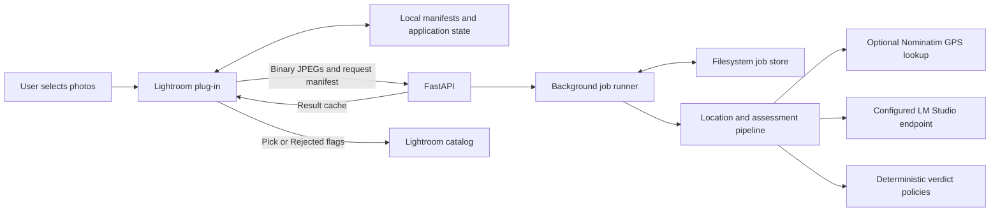
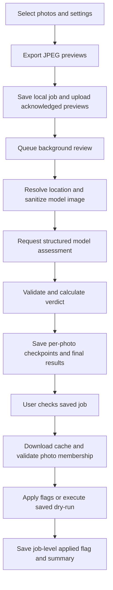

# Architecture, design, and workflow

This describes the current implementation. See [setup](../README.md#setup) for
installation and [compatibility](../README.md#requirements-and-compatibility)
for evidence limits.

## Components

| Component | Source and responsibility |
|---|---|
| Submission | [StockReviewAI.lua](../StockReviewAI.lrplugin/StockReviewAI.lua): export previews, capture settings/context, save and queue the job |
| State/transport | [JobState.lua](../StockReviewAI.lrplugin/JobState.lua), [JobClient.lua](../StockReviewAI.lrplugin/JobClient.lua) |
| Application | [CheckJobStatus.lua](../StockReviewAI.lrplugin/CheckJobStatus.lua): resolve catalog photos, validate results, protect existing flags, apply or dry-run |
| Cancellation | [CancelJob.lua](../StockReviewAI.lrplugin/CancelJob.lua) |
| API/configuration | [main.py](../server/main.py), [config.py](../server/config.py), [models.py](../server/models.py) |
| Persistence/execution | [job_store.py](../server/job_store.py), [job_runner.py](../server/job_runner.py) |
| Inference/policy | [lmstudio_client.py](../server/lmstudio_client.py), [prompt.py](../server/prompt.py) |
| Location | [location_context.py](../server/location_context.py) |

There is no learning database, model training, agency uploader, Develop editor,
or cloud fallback adapter. The configured HTTP endpoint can nevertheless be
remote; local-first operation depends on configuration.

## Design boundaries

AI supplies structured assessments. Strict schema validation checks types,
ranges, and cross-field consistency, including composition defect/severity and
hard-rejection reasons. Backend code determines the final score and verdict;
the model does not execute Lightroom catalog writes.

Editorial/location and observable-evidence rules constrain route value.
Release-sensitive scenes can require editorial treatment. Composition policies
can change effective scores/severity based on subject type, defects, and
correctability. Normally correctable or uncertain composition should not be
treated as evidence that the plug-in actually repairs the image.

The final weighted integer score uses technical 35%, effective composition
25%, and effective route value 40%, rounded via integer arithmetic. Hard-reject
and release-sensitive editorial gates precede the submitted threshold test.
A score alone does not fully explain the verdict. Policies are selection aids,
not agency acceptance, verified releases, or legal clearance.

Lightroom applies only Pick/Rejected flags. Overwrite protection checks current
`pickStatus` at application time, while dry-run/overwrite choices come from the
saved manifest. Catalog writes and the server's filesystem are separate
operations, not a single transaction.

## Workflow

After queued acknowledgment, the Lightroom computer can disconnect while the
backend/model run. This is not a fully offline queue: initial export/upload and
queue acknowledgment still require a reachable backend.

A completed non-dry-run check can write flags directly, without a per-photo
approval step. To evaluate without flag changes, submit with dry-run enabled.
Switching settings afterward does not convert an existing dry-run job into a
flag-writing job.

## Location and image data

Catalog location fields are preferred. Complete country/region/city/sublocation
context avoids an unnecessary lookup. If incomplete and JPEG GPS is available,
Nominatim can fill missing fields; catalog fields win when merging. Missing GPS
or geocoder failure permits review with the remaining/absent context.

The model-bound JPEG passes through removal of EXIF/IPTC-related segments after
location resolution. This is not a universal anonymization guarantee. Original
uploaded/local previews and manifests remain available for recovery and can
still contain sensitive metadata. See [SECURITY.md](../SECURITY.md).

## Persistence and duplicate safeguards

| Mechanism | What it protects |
|---|---|
| Client job ID and manifest fingerprint | Identical retry reuses input; different data with same ID conflicts |
| Preview hashes | Identical bytes can be acknowledged without replacement; conflicting upload bytes are rejected |
| Active set within runner process | Avoids ordinary duplicate execution of the same active job |
| Photo checkpoints | Resume skips already completed photo reviews |
| Cached downloaded result | Catalog retry does not require new inference |
| Catalog identity/result membership checks | Reject wrong catalog, missing photos, or mismatched result structures |
| Local applied/closed flags | Prevent ordinary reopening/application of resolved client jobs |

Backend files are individually replaced atomically. Worker/cancel bookkeeping
is process-local, so use one Uvicorn process for the shared store. Multiple
jobs/parallel photos are supported through the configured runner, not through
independent processes competing for the same files.

No per-photo applied checkpoint or original-flag snapshot is saved.
Lightroom uses one write-access scope, then saves a job-level applied flag.
A failure/crash can leave uncertainty between catalog changes and local state.
With overwrite protection, existing flags are skipped on retry; with overwrite
enabled, verdicts can replace intervening manual flags. Neither behavior
constitutes a crash-safe exactly-once guarantee.

## Cancellation, resume, and rollback

Server cancellation immediately marks a job cancelled and requests stopping.
Status persistence prevents later normal updates from reviving a cancelled
state. In-flight inference can finish or unwind afterward; retained checkpoints
and previews are not erased.

The plug-in's explicit Cancel Active Job confirms the action and closes local
state after acknowledgment. If the server says already completed, the client
can still close the job without applying results. Cancelled jobs cannot be
requeued. Local cancelled state is not proof the model runtime has instantly
released all compute resources.

Startup marks jobs previously running as interrupted. Check Job Status offers
explicit resume for failed/interrupted jobs and reuses completed checkpoints.
Submission recovery can query/upload missing previews using the saved manifest.

Neither cancellation nor closing/deleting files restores flags. No dedicated
completed-job rollback routine exists. Inspect any partial application before
retry and use appropriate Lightroom Undo/catalog backup recovery if needed.

## Storage and operational limits

Default backend job root is `server/jobs/`; relative overrides resolve against
the server module directory. Local plug-in data defaults to
Documents/StockReviewAI Jobs. Server diagnostics and plug-in result logs can
contain paths, location context, reasons, and model-response excerpts.

No automatic retention period or application-level encryption is implemented.
The API has no inbound authentication, authorization, or built-in TLS.
See [security](../SECURITY.md), [updates](../README.md#updating), and
[recovery](../README.md#recovery-and-rollback).
